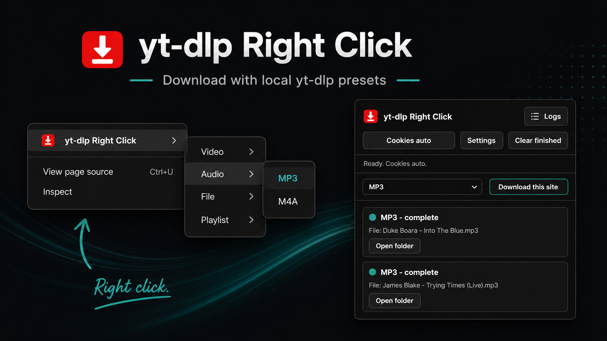

# yt-dlp Right Click

<p align="center">
  
</p>

<p align="center">
  <a href="https://github.com/biggiesmallcap-blip/yt-dlp-right-click/releases/latest"></a>
  
  
  
</p>

## About

`yt-dlp Right Click` adds local `yt-dlp` download presets directly to Chrome's right-click menu and extension popup.

It is built for people who already use `yt-dlp` on Windows and want a quick browser-side launcher without copying URLs into a terminal. The extension captures the current page, link, selected URL, image, video, or audio URL, then sends it to a local Rust native messaging host.

Chrome extensions cannot launch local programs by themselves. This project uses Chrome's native messaging system: the browser extension handles the UI, and the native host handles local execution. The host validates every request, maps preset IDs to hardcoded `yt-dlp` arguments, and launches `yt-dlp.exe` directly without a shell.

## Highlights

- Right-click any page, link, selected URL, image, video, or audio element, or use "Download again" to repeat your last preset.
- Live progress, speed, and time left in the popup, with Cancel and Resume.
- Preset-only commands for MP4 video, MP3 (VBR or 320 kbps), M4A, original audio, best file, playlists, and Instagram.
- Audio files tagged with title, artist, and cover art.
- Desktop notifications when downloads finish; click one to open the folder.
- "Show in folder" selects the saved file in Explorer.
- Clean `Title.ext` filenames instead of noisy video IDs.
- Cookies only when a site asks for login, from your choice of browser or a cookies.txt file.
- yt-dlp kept up to date automatically (stable or nightly), plus a notice when a new extension release is out.
- "Check setup" reports native host, yt-dlp, and ffmpeg versions and warns when something is stale or misconfigured.

## Download

Grab the latest GitHub release:

[Download the latest release](https://github.com/biggiesmallcap-blip/yt-dlp-right-click/releases/latest)

Release assets:

- `yt-dlp-right-click-extension-v<version>.zip`
- `yt-dlp-right-click-native-host-windows-v<version>.zip`

The native host ZIP includes a prebuilt `ytdlp_native_host.exe`. Release users do not need Rust, Cargo, or a local build step.

## Prerequisites

| Requirement | Why it is needed | Notes |
| --- | --- | --- |
| Windows | The native host and installer target Windows. | User-level install; no administrator rights required. |
| Google Chrome | The extension is a Chrome MV3 extension. | Chromium-based browsers may work if they support Chrome native messaging, but Chrome is the supported target. |
| `yt-dlp.exe` | Performs the actual download. | Set either the full `yt-dlp.exe` path or its containing folder in extension settings. |
| `ffmpeg.exe` | Required for MP4 merging and audio extraction presets. | Set either the full `ffmpeg.exe` path or the folder containing it. |
| Download folder | Where output files, logs, and subfolders are written. | The host creates `Video`, `Audio`, `Files`, `Instagram`, and `_yt-dlp-right-click-logs` under this root. Logs older than 30 days are pruned. |
| JavaScript runtime | Modern YouTube extraction needs one. | Leave on `Automatic`; Node.js, Deno, QuickJS, or Bun are detected. |

What is bundled:

- Chrome extension files in the extension ZIP.
- A prebuilt `ytdlp_native_host.exe` in the Windows native host ZIP.
- Installer scripts that register the native host for the current Windows user.

What is not bundled:

- `yt-dlp.exe`
- `ffmpeg.exe`
- browser cookies or account credentials
- any DRM, paywall, or site-restriction bypass

## Presets

| Group | Presets |
| --- | --- |
| Video | Best MP4, MP4 up to 1080p, Small MP4 up to 720p |
| Audio | MP3 (VBR best), MP3 320 kbps, M4A, Original audio (no re-encode) |
| File | Best single file |
| Playlist | Whole playlist as MP4, Whole playlist as MP3 |
| Instagram | Post, reel, or carousel; Stories and highlights backup |

Playlists are only enabled from explicit playlist menu items. Normal video/audio/file presets use `--no-playlist`.

The Instagram group only appears on instagram.com and is meant for backing up your own account. It uses your logged-in cookies and saves to `Instagram\<account>\`. The stories backup keeps an archive so repeat runs only fetch new items. Right-click a profile page to back up that profile's current stories, or a highlight to save the highlight.

## Quick Install

These steps target Google Chrome on Windows.

1. Install or unpack the Chrome extension.
2. Download and unzip the `yt-dlp-right-click-native-host-windows-v<version>.zip` release asset.
3. Double-click `install-native-host.cmd`.
4. Paste the extension ID if prompted.
5. Open the extension settings page.
6. Set paths for `yt-dlp.exe`, `ffmpeg.exe`, and your download folder.
7. Click `Check setup`.

The native host must be installed once so Chrome knows which local executable is allowed to receive messages from this extension. It does not have to be built by the user.

For development from source:

```powershell
cd native-host
cargo build --release
cd ..
.\scripts\install-native-host.ps1 -ExtensionId "<your-extension-id>"
```

See [docs/INSTALL.md](docs/INSTALL.md) for full setup and troubleshooting.

## Security Model

The extension can collect a URL and preset ID. It cannot choose arbitrary command-line arguments.

The native host:

- accepts only `http://` and `https://` URLs
- rejects `file:`, `javascript:`, `data:`, `chrome:`, and `blob:` URLs
- validates paths as absolute local paths
- launches `yt-dlp.exe` directly with an argument array
- passes the URL after `--` so it can never be read as an option
- allowlists every setting that reaches the command line (cookie browser, update channel, JS runtime)
- restricts final output, `Show in folder`, and `Show log file` to the configured download root
- excludes generated native host manifests from release artifacts

See [SECURITY.md](SECURITY.md) for the trust boundary and expected limits.

## Project Layout

```text
extension/       Chrome MV3 extension (shared.js holds presets and pure helpers)
native-host/     Rust native messaging host
scripts/         Windows install, uninstall, and release packaging scripts
docs/            Install and release documentation
tests/           Node unit tests for the extension helpers
```

## Build Release Artifacts

```powershell
.\scripts\package-release.ps1 -Version 1.1.0
```

The script creates extension and native-host ZIP files under `dist\1.1.0`. The native host ZIP is assembled from a whitelist, so local generated manifests are not included.

## Public Build Note

Do not publish `native-host/com.ytdlp_right_click.native_host.json` from a local machine. It is generated by the install script and contains an absolute user-specific executable path plus the installed Chrome extension ID.

Use `native-host/com.ytdlp_right_click.native_host.template.json` as documentation/template only.
