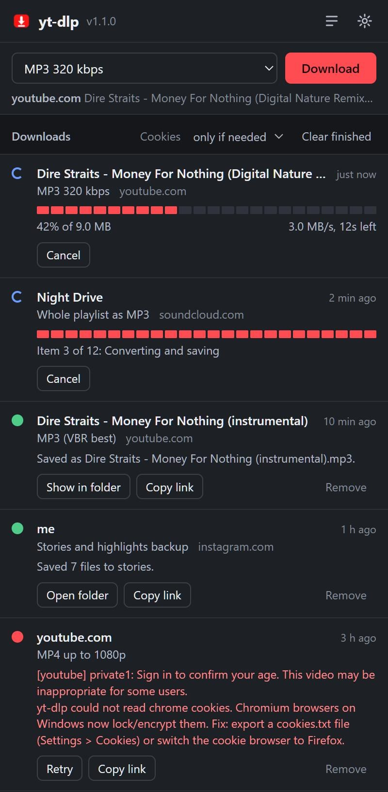

# yt-dlp Right Click

<p align="center">
  
</p>

<p align="center">
  <a href="https://github.com/biggiesmallcap-blip/yt-dlp-right-click/releases/latest"></a>
  
  
  
</p>

## About

`yt-dlp Right Click` adds local `yt-dlp` download presets directly to Chrome's right-click menu and extension popup.

It is built for people who already use `yt-dlp` on Windows and want a quick browser-side launcher without copying URLs into a terminal. The extension captures the current page, link, selected URL, image, video, or audio URL, then sends it to a local Rust native messaging host.

Chrome extensions cannot launch local programs by themselves. This project uses Chrome's native messaging system: the browser extension handles the UI, and the native host handles local execution. The host validates every request, maps preset IDs to hardcoded `yt-dlp` arguments, and launches `yt-dlp.exe` directly without a shell.

## What's New in 1.2

Setup is now one download and one double-click. `Setup.cmd` installs everything, fetches yt-dlp, ffmpeg, and Deno if you don't have them, and the extension fills in its own settings. No extension ID to copy, no paths to type. Full list in [CHANGELOG.md](CHANGELOG.md).

## Highlights

<p align="center">
  
</p>

- Right-click any page, link, selected URL, image, video, or audio element, or use "Download again" to repeat your last preset.
- Live progress, speed, and time left in the popup, with Cancel and Resume.
- Preset-only commands for MP4 video, MP3 (VBR or 320 kbps), M4A, original audio, best file, playlists, and Instagram.
- Audio files tagged with title, artist, and cover art.
- Desktop notifications when downloads finish; click one to open the folder.
- "Show in folder" selects the saved file in Explorer.
- Clean `Title.ext` filenames instead of noisy video IDs.
- Cookies only when a site asks for login, from your choice of browser or a cookies.txt file.
- yt-dlp kept up to date automatically (stable or nightly), plus a notice when a new extension release is out.
- "Check setup" reports native host, yt-dlp, and ffmpeg versions and warns when something is stale or misconfigured.

## Install

Works on Windows with Google Chrome (or Edge). No admin rights needed.

1. **Download** `yt-dlp-right-click-v<version>-windows.zip` from the [latest release](https://github.com/biggiesmallcap-blip/yt-dlp-right-click/releases/latest) and unzip it anywhere.
2. **Double-click `Setup.cmd`.** If Windows says "Windows protected your PC", click **More info**, then **Run anyway**. Press Enter when it offers to download yt-dlp, ffmpeg, and Deno.
3. **In the Chrome tab Setup opens:** turn on **Developer mode** (top right), click **Load unpacked**, press **Ctrl+V**, and click **Select Folder**. Setup already copied the right folder path.

Done. Right-click any video and choose **yt-dlp**. The extension finds yt-dlp and ffmpeg by itself; its Settings page shows "Ready" when everything works.

Everything is installed to `%LOCALAPPDATA%\yt-dlp-right-click`, so the folder you unzipped can be deleted afterwards. Downloads go to `Downloads\yt-dlp` unless you change it in Settings.

**Updating:** download the new zip, run its `Setup.cmd`, then click the reload arrow on the yt-dlp Right Click card in `chrome://extensions`.

**Uninstalling:** run `Uninstall.cmd`, then click **Remove** in `chrome://extensions`. Your downloaded files are kept.

**Why the "Developer mode" step?** Extensions not sold through the Chrome Web Store can only be added this way. The helper program Setup installs is what lets the extension start yt-dlp; Chrome extensions can't run programs on their own.

## Presets

| Group | Presets |
| --- | --- |
| Video | Best MP4, MP4 up to 1080p, Small MP4 up to 720p |
| Audio | MP3 (VBR best), MP3 320 kbps, M4A, Original audio (no re-encode) |
| File | Best single file |
| Playlist | Whole playlist as MP4, Whole playlist as MP3 |
| Instagram | Post, reel, or carousel; Stories and highlights backup |

Playlists are only enabled from explicit playlist menu items. Normal video/audio/file presets use `--no-playlist`.

The Instagram group only appears on instagram.com and is meant for backing up your own account. It uses your logged-in cookies and saves to `Instagram\<account>\`. The stories backup keeps an archive so repeat runs only fetch new items. Right-click a profile page to back up that profile's current stories, or a highlight to save the highlight.

## Upgrading from 1.0 or 1.1

1.2 gives the extension a fixed ID, so Chrome treats it as a new extension once:

1. Run the new `Setup.cmd` as above.
2. In `chrome://extensions`, click **Remove** on the old yt-dlp Right Click, then **Load unpacked** the new folder (Setup copies its path).

Settings fill themselves in again from what Setup found. If you used a custom download folder, set it once more in Settings. Download history from the old copy is not carried over.

## Building from Source

```powershell
cd native-host
cargo build --release
cd ..
.\scripts\install-native-host.ps1
```

Then load the `extension` folder with **Load unpacked**. The extension's ID is fixed by the `key` in `manifest.json`, so the install script needs no ID. See [docs/INSTALL.md](docs/INSTALL.md) for details.

## Troubleshooting

| Symptom | Fix |
| --- | --- |
| "The helper program isn't installed yet" | Run `Setup.cmd` from the download. |
| Popup says the helper is older than the extension | Run the newest `Setup.cmd`, or rebuild from source. |
| "Could not read chrome cookies" or "Failed to decrypt with DPAPI" | Chrome, Edge, and Brave on Windows encrypt cookies in a way yt-dlp often cannot read. Export a cookies.txt file and set it under Settings > Cookies, or choose Firefox as the cookie browser. |
| "Sign in to confirm you're not a bot" | Usually fixed by updating yt-dlp (Settings > Update yt-dlp now), then by cookies. |
| Audio conversion or merging fails | Update ffmpeg; very old builds (2020 and earlier) fail on some formats and on long paths. |
| A download stopped when the browser closed | Expected: closing Chrome or reloading the extension stops running downloads. Retry resumes from the partial file. |

## Security Model

The extension can collect a URL and preset ID. It cannot choose arbitrary command-line arguments.

The native host:

- accepts only `http://` and `https://` URLs
- rejects `file:`, `javascript:`, `data:`, `chrome:`, and `blob:` URLs
- validates paths as absolute local paths
- launches `yt-dlp.exe` directly with an argument array
- passes the URL after `--` so it can never be read as an option
- runs yt-dlp with `--ignore-config`, so no config file (including one a download might drop into the output folder) can add options such as `--exec`
- allowlists every setting that reaches the command line (cookie browser, update channel, JS runtime)
- reads titles and file paths back as JSON, so page-controlled titles cannot spoof progress or results
- stops yt-dlp when the browser disconnects instead of leaving it running unattended
- restricts final output, `Show in folder`, and `Show log file` to the configured download root
- excludes generated native host manifests from release artifacts

See [SECURITY.md](SECURITY.md) for the trust boundary and expected limits.

## Project Layout

```text
extension/       Chrome MV3 extension (shared.js holds presets and pure helpers)
native-host/     Rust native messaging host
scripts/         Windows install, uninstall, and release packaging scripts
docs/            Install and release documentation
tests/           Node unit tests for the extension helpers
```

## Build Release Artifacts

```powershell
.\scripts\package-release.ps1 -Version 1.2.0
```

The script creates `dist\1.2.0\yt-dlp-right-click-v1.2.0-windows.zip`, assembled from a whitelist, so local generated manifests and settings are never included.

## Public Build Note

Do not publish `native-host/com.ytdlp_right_click.native_host.json` from a local machine. It is generated by the install script and contains an absolute user-specific executable path plus the installed Chrome extension ID.

Use `native-host/com.ytdlp_right_click.native_host.template.json` as documentation/template only.
